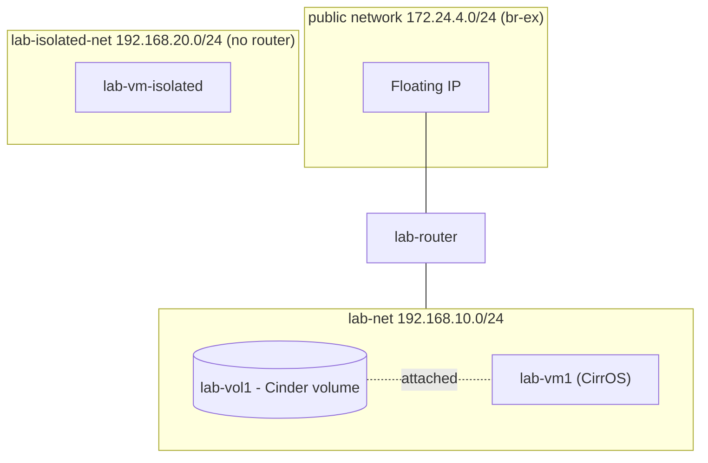

# OpenStack Private Cloud Lab (DevStack)

A hands-on, reproducible lab that builds a **single-node OpenStack private cloud with DevStack** and exercises the core services through both the **Horizon dashboard** and the **OpenStack CLI**. Every lab has step-by-step instructions *and* an idempotent script, so the whole environment can be rebuilt from scratch in minutes after the initial install.


## What this project covers

| # | Area | What is done | Lab | Script |
|---|------|--------------|-----|--------|
| 1 | **DevStack** | Single-node install, access via Horizon and CLI | [01](labs/01-environment-setup.md) | `devstack/install.sh`, `scripts/health-check.sh` |
| 2 | **Keystone** | Projects, users, roles (member / reader / admin), quotas, RBAC test | [02](labs/02-keystone-identity.md) | `scripts/01-keystone-setup.sh` |
| 3 | **Glance** | Upload, tag, share, download and manage images | [03](labs/03-glance-images.md) | `scripts/02-glance-images.sh` |
| 4 | **Nova** | Custom flavors, keypairs, launching and managing instances, instance snapshots | [04](labs/04-nova-compute.md) | `scripts/03-nova-flavors.sh`, `scripts/05-launch-instances.sh` |
| 5 | **Neutron** | Networks, subnets, router, security groups, floating IPs, network isolation | [05](labs/05-neutron-networking.md) | `scripts/04-neutron-network.sh` |
| 6 | **Cinder** | Persistent volumes, attach/detach, snapshots, restore | [06](labs/06-cinder-storage.md) | `scripts/06-cinder-volume.sh` |
| 7 | **Troubleshooting** | Reproduce and diagnose failed instance launches from service logs | [07](labs/07-troubleshooting.md) | `scripts/07-troubleshooting-demos.sh`, `scripts/collect-logs.sh` |

## Lab topology



More diagrams (service interaction, instance-launch flow) are in [docs/architecture.md](docs/architecture.md).

## Requirements

| Resource | Minimum | Recommended |
|----------|---------|-------------|
| OS | Ubuntu 22.04 / 24.04 (fresh VM) | **Ubuntu 24.04 LTS** |
| RAM | 8 GB | 16 GB |
| vCPU | 2 | 4+ |
| Disk | 40 GB | 60+ GB |
| Virtualisation | works without KVM (slow QEMU) | nested virtualisation / bare metal |
| Network | internet access to `opendev.org` | bridged or host-only adapter so Horizon is reachable |

> Run DevStack in a **throw-away VM**, never on your daily-driver machine. It rewrites networking and installs system packages. Take a VM snapshot after a successful install.

## Quick start

```bash
# 1. On a fresh Ubuntu 24.04 VM (as a normal sudo user, not root)
git clone https://github.com/<your-username>/openstack-private-cloud-lab.git
cd openstack-private-cloud-lab
chmod +x devstack/install.sh scripts/*.sh

# 2. Pick a password
nano devstack/local.conf.example          # change ADMIN_PASSWORD

# 3. Install OpenStack (20-40 min) - use tmux so an SSH drop doesn't kill it
tmux new -s stack
./devstack/install.sh

# 4. Verify and run all labs
./scripts/health-check.sh
./scripts/run-all.sh

# 5. Explore: Horizon at http://<HOST_IP>/dashboard
#    domain: default | user: admin | password: your ADMIN_PASSWORD
```

Run a single lab instead: `./scripts/04-neutron-network.sh`. Tear everything down (keeps DevStack itself): `./scripts/99-cleanup.sh`.

DevStack branch: `install.sh` defaults to `stable/2025.2`. Use a newer stable release with
`DEVSTACK_BRANCH=stable/<release> ./devstack/install.sh` ([release list](https://releases.openstack.org)).

## Repository layout

```
.
├── README.md
├── devstack/
│   ├── install.sh              # create stack user, clone DevStack, write local.conf, run stack.sh
│   └── local.conf.example      # single-node config (Keystone, Glance, Nova, Neutron, Cinder, Horizon)
├── config/
│   ├── lab.env                 # names, CIDRs, flavors - one place to customise the lab
│   └── user-data.sh            # cloud-init script: tiny web server inside the guest
├── scripts/
│   ├── lib/common.sh           # auth switching, wait helpers, SSH helper
│   ├── prereq-check.sh         # pre-install host checks
│   ├── health-check.sh         # post-install service health
│   ├── 01-keystone-setup.sh ... 06-cinder-volume.sh
│   ├── 07-troubleshooting-demos.sh
│   ├── collect-logs.sh         # one-shot diagnostic bundle
│   ├── run-all.sh
│   └── 99-cleanup.sh
├── labs/                       # step-by-step guides (CLI + Horizon for each service)
├── docs/
│   ├── architecture.md
│   └── cheatsheet.md           # most useful commands on one page
└── screenshots/                # evidence of the lab running (see screenshots/README.md)
```

## How the scripts work

* `lib/common.sh` sources DevStack's own `openrc` once as `admin`, then switches identity with `as_admin`, `as_lab` or `as_reader`. Admin-only actions (flavors, public images, users, quotas) run as admin; everything a tenant would do (networks, instances, volumes) runs as the unprivileged `labuser` in `lab-project`, which mirrors real-world separation of duties.
* Each script checks whether a resource already exists before creating it, so re-running is safe (the exception is `06-cinder-volume.sh`, which formats a disk; reset with `99-cleanup.sh`).
* Credentials for the lab users are written to `labuser-openrc.sh` / `labreader-openrc.sh`, which are **git-ignored**.

## Security notes

This is a learning lab, not a hardened deployment.

* Passwords in `local.conf.example` and `config/lab.env` are placeholders. Change them, and never commit real ones (`local.conf`, `*-openrc.sh` and `*.pem` are in `.gitignore`).
* Don't expose the DevStack host's Horizon/API ports to the internet.
* The security groups open SSH/ICMP/HTTP to `0.0.0.0/0` inside the lab network only; tighten `--remote-ip` for anything real.

## Known limitations

* DevStack is for development and testing: it is not designed to survive reboots reliably. Snapshot the VM after installing; if services don't return, see [Lab 07](labs/07-troubleshooting.md#after-a-reboot).
* Single node, so no live migration, no resize-to-another-host, no HA.
* Floating IPs are reachable from the DevStack host itself. To reach them from other machines you need extra routing/NAT (see [Lab 05](labs/05-neutron-networking.md#reaching-floating-ips-from-outside-the-host)).

## Evidence

Add your own screenshots to [`screenshots/`](screenshots/README.md) (checklist included) and link them here, for example:

```markdown

```

## Skills demonstrated

Private-cloud administration with OpenStack · DevStack deployment · Keystone RBAC and multi-tenancy · Nova scheduling and flavors · Glance image lifecycle · Neutron virtual networking (L2/L3, NAT, security groups) · Cinder block storage · Linux service troubleshooting with `systemd`/`journalctl` · Bash automation and idempotent scripting · Technical documentation

## References

* [DevStack documentation](https://docs.openstack.org/devstack/latest/)
* [OpenStack user guide / CLI reference](https://docs.openstack.org/python-openstackclient/latest/)
* [Nova](https://docs.openstack.org/nova/latest/) · [Neutron](https://docs.openstack.org/neutron/latest/) · [Cinder](https://docs.openstack.org/cinder/latest/) · [Glance](https://docs.openstack.org/glance/latest/) · [Keystone](https://docs.openstack.org/keystone/latest/)

## License

[MIT](LICENSE)
