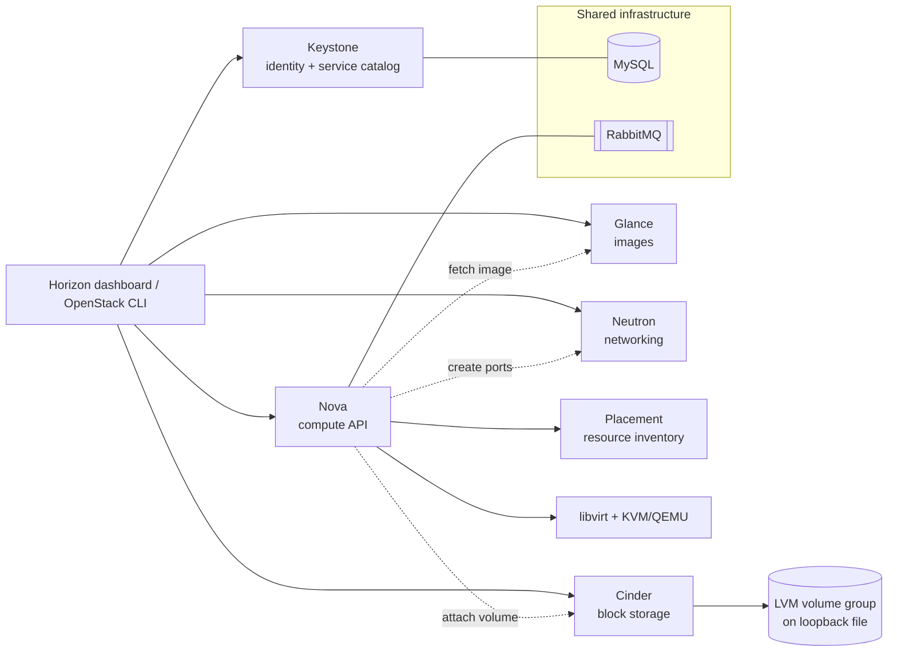
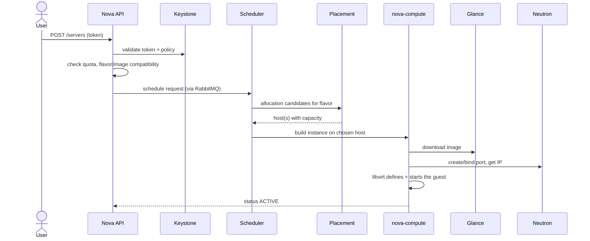

# Architecture

## Services in this lab

| Service | Role | DevStack unit (journal) |
|---------|------|-------------------------|
| Keystone | Authentication, projects, users, roles, service catalog | `devstack@keystone` |
| Glance | Image registry and storage | `devstack@g-api` |
| Placement | Tracks resource inventory/usage for scheduling | `devstack@placement-api` |
| Nova | `n-api`, `n-sch` (scheduler), `n-cond-cell1` (conductor), `n-cpu` (compute) | `devstack@n-*` |
| Neutron | API server (`q-svc`) + OVN backend | `devstack@q-svc`, `ovn-*` |
| Cinder | `c-api`, `c-sch`, `c-vol` | `devstack@c-*` |
| Horizon | Web UI served by Apache | `apache2`, `/var/log/apache2/horizon_error.log` |

List what is actually running on your host: `systemctl list-units 'devstack@*'`.

## What happens when you launch an instance

Where it can fail, and which log to read:

| Stage | Typical failure | Look at |
|-------|-----------------|---------|
| Token / policy | 401 / 403 | `devstack@keystone`, role assignments |
| Quota, flavor vs image | HTTP 403 / 400 returned immediately | `openstack limits show`, flavor + image properties |
| Scheduling | `No valid host was found` | `devstack@n-sch`, `devstack@placement-api` |
| Build on host | status `ERROR`, fault message | `devstack@n-cpu`, `/var/log/libvirt/qemu/` |
| Networking | port binding failed, no IP | `devstack@q-svc`, console log |
| Volume | stuck `creating` / `error` | `devstack@c-sch`, `devstack@c-vol`, `openstack volume service list` |

## Network layout

| Network | CIDR | Purpose |
|---------|------|---------|
| `public` (created by DevStack) | `172.24.4.0/24` | External network / floating IP pool, attached to `br-ex` |
| `lab-net` | `192.168.10.0/24` | Routed tenant network (via `lab-router`) |
| `lab-isolated-net` | `192.168.20.0/24` | Tenant network with **no router**, proves isolation |

Names and CIDRs are set in [`config/lab.env`](../config/lab.env).
